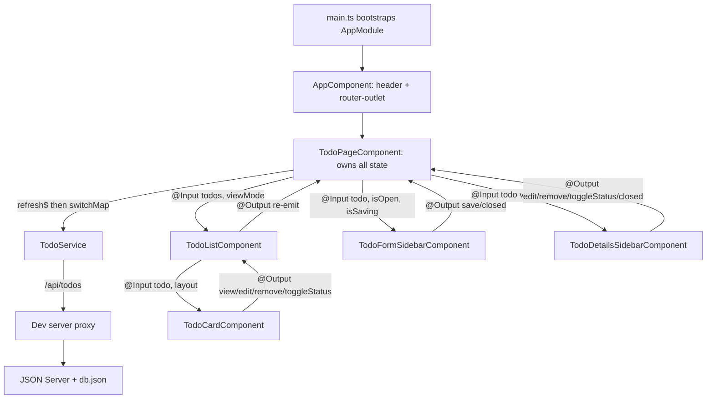

# Angular 16 Todo Manager

A small but complete Todo app built to learn Angular 16 through real code: NgModules, component communication, directives, pipes, Reactive Forms, RxJS and HttpClient. It uses a JSON Server mock REST API, and everything runs in Docker.

## What is implemented

- **Dashboard**: a completion progress bar plus stat cards for total, completed, pending and high-priority todos.
- **Todo list with two layouts**: **List** (compact rows, the default) and **Cards** (grid), switchable from the toolbar.
- **Create and edit** in one reusable right-side form sidebar, with validation.
- **Details sidebar** with Edit, Mark complete/pending and Delete actions.
- **Mark complete / pending** with the round checkbox on each todo, or from the details sidebar.
- **Delete** with a confirmation prompt.
- **Search** by title or description (debounced), and **filters** by status and priority.
- **Loading skeletons, empty, no-results and error states**, plus an animated toast after every save, status change or delete (it also shows save errors above an open form).
- **Accessible sidebars**: dialog semantics, focus moves into the panel and stays there while Tab/Shift+Tab cycles, Escape/backdrop/× close it, and focus returns to the element that opened it.
- **Design**: light SaaS-style theme with the Inter font, soft shadows, coloured status and priority badges, a sticky header, and a responsive layout for desktop and mobile.

## Tech stack and why

| Library / tool | Version | Why it is used |
| --- | --- | --- |
| Angular (core, common, forms, router, platform-browser) | 16.2 | The framework being learned. NgModule-based, to match existing Angular 16 enterprise apps |
| TypeScript | 5.1 | Version supported by Angular 16.2; strict mode and strict templates are on |
| RxJS | 7.8 | Angular's async model: `HttpClient` returns Observables; used for refresh, search and details streams |
| zone.js, tslib | 0.13, 2.x | Required runtime pieces of Angular 16 (change detection, TS helpers) |
| SCSS | built in | Plain component styles with shared design tokens; no UI framework to learn on top |
| Inter font (Google Fonts) | | Cleaner, more legible UI type. Loaded with a `<link>` in `index.html` (no npm package); falls back to the system font when offline |
| JSON Server | 0.17.4 | Zero-code REST API over `db.json`, with predictable CRUD and sorting |
| Docker + Docker Compose (`node:18-alpine`) | Node 18 | No Node.js or Angular CLI needed on the host; same environment for everyone |

Deliberately **not** used: Angular Material, Bootstrap or Tailwind (custom SCSS is easier to follow); an icon library (the few icons are small inline SVGs); NgRx (one page component holds the state); a modal library (native `window.confirm()` for deletes); a test runner (the project focuses on app code).

## Running the app

Docker Desktop is the only prerequisite.

```bash
docker compose up --build      # start (the first run installs dependencies)
docker compose down            # stop
```

- App: <http://localhost:4200>
- API: <http://localhost:3000/todos>

Editing files under `frontend/src` rebuilds the app and reloads the browser automatically. The dev server polls for changes (`ng serve --poll 2000`) because file events don't cross from Windows into Docker.

Angular CLI commands run inside the container:

```bash
docker compose exec frontend npx ng version
docker compose exec frontend npx ng generate component features/todos/example
```

Generated components appear in your local `frontend/` folder (SCSS, no spec file) and are declared in `AppModule` automatically.

After changing `package.json`, run `docker compose exec frontend npm install`. To start completely fresh, run `docker compose down -v` (this deletes the dependency volume), then `docker compose up --build`.

## How the frontend connects to the backend

```text
Browser ──/api/todos──▶ Angular dev server :4200 ──proxy──▶ JSON Server backend:3000/todos ──▶ backend/db.json
```

1. `TodoService` (`core/services/todo.service.ts`) is the only place that uses `HttpClient`. It always calls the relative URL `/api/todos`, so the browser only ever talks to port 4200 and no CORS setup is needed.
2. `frontend/proxy.conf.json` (enabled in `angular.json` under `serve.options.proxyConfig`) forwards `/api/*` to `http://backend:3000` and strips the `/api` prefix. `backend` is the Docker Compose service name, so it's only used by the dev server inside Docker, never by browser code.
3. JSON Server reads and writes `backend/db.json`, which is bind-mounted into its container, so changes persist on your machine.

| `TodoService` method | Browser request | JSON Server receives |
| --- | --- | --- |
| `getTodos()` | `GET /api/todos?_sort=createdAt&_order=desc` | `GET /todos?...` (newest first) |
| `getTodoById(id)` | `GET /api/todos/:id` | `GET /todos/:id` |
| `createTodo(data)` | `POST /api/todos` | `POST /todos` (server assigns `id`; the service adds `createdAt`) |
| `updateTodo(id, data)` | `PATCH /api/todos/:id` | `PATCH /todos/:id` (only the sent fields change) |
| `deleteTodo(id)` | `DELETE /api/todos/:id` | `DELETE /todos/:id` |

## Application flow



1. **Startup**: `main.ts` bootstraps `AppModule`. `AppRoutingModule` maps `''` to `TodoPageComponent`, which renders inside `AppComponent`'s `<router-outlet>`.
2. **Loading**: the page's `refresh$` subject starts with one value, so the list loads straight away. Each emission sets `isLoading`, then `switchMap` calls `getTodos()`. A newer refresh cancels a request that's still pending, and `catchError` turns a failure into an error message without ending the stream.
3. **Displaying**: while the first request is pending, skeleton rows are shown. After loading, the page recalculates the stat cards, the completion percentage (bound to the progress bar with `[style.width.%]`) and `visibleTodos` (search + status + priority filters applied locally). It passes `visibleTodos` and `viewMode` down to `TodoListComponent`, which renders one `TodoCardComponent` per todo.
4. **Searching and filtering**: the search box is a `FormControl`. Its `valueChanges` stream uses `debounceTime(300)`, `map` (trim + lowercase) and `distinctUntilChanged()`, then re-filters the todos already in memory, without any HTTP request.
5. **User actions**: a card never changes data itself. It emits an `@Output()` event, the list forwards it, and the page calls `TodoService`. After every successful create, update, status toggle or delete, the page calls `loadTodos()` to refetch. This single, consistent approach keeps the UI in sync with the server.
6. **Sidebars**: `activeSidebar` (`'form' | 'details' | null`) decides which panel is open, so only one can be open at a time. The details sidebar shows the clicked todo immediately (`startWith`) and then the latest server copy (`getTodoById` inside `switchMap`, bound with the `async` pipe).
7. **Cleanup**: long-lived subscriptions use `takeUntilDestroyed()`, called in the constructor because it needs an injection context. One-off HTTP calls complete on their own.

## Components and files

| File / component | Responsibility | Inputs → Outputs |
| --- | --- | --- |
| `app.module.ts` | Declares every component, the directive and the pipe; imports `BrowserModule`, `HttpClientModule`, `ReactiveFormsModule`, `AppRoutingModule` | |
| `app-routing.module.ts` | `''` → `TodoPageComponent`, unknown URLs redirect home | |
| `AppComponent` | Sticky app header and `<router-outlet>` | |
| `TodoPageComponent` | Container: loads data, holds state (todos, stats, filters, view mode, sidebars, toast), calls the service. Its template contains the progress bar, stat cards, toolbar, toast and the loading/empty/error states | |
| `TodoListComponent` | Renders todos with `*ngFor` + `trackBy` in list or card layout | `todos`, `viewMode` → `view`, `edit`, `remove`, `toggleStatus` |
| `TodoCardComponent` | One todo (row or card): round complete checkbox, clickable title, badges, dates, Edit/Delete | `todo`, `layout` → `view`, `edit`, `remove`, `toggleStatus` |
| `TodoFormSidebarComponent` | Typed Reactive Form for create and edit | `todo` (null = create), `isOpen`, `isSaving` → `save`, `closed` |
| `TodoDetailsSidebarComponent` | Read-only details with actions | `todo`, `isOpen` → `edit`, `remove`, `toggleStatus`, `closed` |
| `SidebarComponent` (shared) | Reusable panel shell: backdrop, slide animation, close button, Escape, focus on open, focus trap, focus restore. Content is projected with `<ng-content>` plus a `[sidebar-footer]` slot | `heading`, `isOpen` → `closed` |
| `PriorityHighlightDirective` | `[appPriorityHighlight]`: red left border on high-priority todos via `Renderer2` | `appPriorityHighlight` |
| `PriorityLabelPipe` | `high` → `High Priority` | |
| `TodoService` | All HTTP calls | |
| `todo.model.ts` | `Todo`, `TodoPriority`, `TodoStatus`, `TodoViewMode`, `CreateTodoRequest` | |
| `styles.scss` | Design tokens (colours, radius, shadows, focus ring) and shared buttons, badges, form fields and the segmented control | |
| `index.html`, `favicon.svg` | Page shell, Inter font link and the app icon (also used as the header logo) | |

Form validation: title is required, can't be only spaces, and must be 3 to 100 characters (counted without surrounding spaces, since it's saved trimmed). Description is up to 500 characters. Priority and status are selects with fixed options. Due date is an optional `<input type="date">`, stored as `YYYY-MM-DD` or `null`.

## Folder structure

```text
├── docker-compose.yml          # frontend + backend services, node_modules volume
├── backend/
│   ├── Dockerfile              # installs json-server 0.17.4
│   └── db.json                 # the "database" (seed todos)
└── frontend/
    ├── Dockerfile              # node:18-alpine, npm install, ng serve
    ├── proxy.conf.json         # /api → JSON Server
    ├── angular.json            # CLI config (proxy, SCSS, no spec files, cache location)
    ├── tsconfig.json           # strict TypeScript + strict templates
    └── src/
        ├── index.html, main.ts, styles.scss, favicon.svg
        └── app/
            ├── app.module.ts, app-routing.module.ts, app.component.*
            ├── core/
            │   ├── models/todo.model.ts
            │   └── services/todo.service.ts
            ├── shared/
            │   ├── components/sidebar/
            │   ├── directives/priority-highlight.directive.ts
            │   └── pipes/priority-label.pipe.ts
            └── features/todos/
                ├── todo-page/  todo-list/  todo-card/
                └── todo-form-sidebar/  todo-details-sidebar/
```

`frontend/node_modules` stays empty on your machine. It's the mount point for the `frontend_node_modules` Docker volume, which holds the real Linux dependencies and Angular's build cache (`node_modules/.cache/angular`), so they never mix with your host.

See [LEARNING_MAP.md](LEARNING_MAP.md) for a concept-by-concept map of where each Angular feature is used.

## Notes and limitations

- Deleting uses the browser's native `window.confirm()` instead of a custom modal.
- When the backend container is stopped, the dev proxy takes about 20 seconds to fail, because Docker's DNS lookup for `backend` has to time out. Until then, the loading skeleton is shown; after that, the error message appears with a "Try again" button.
- JSON Server's `--watch` doesn't see edits made to `backend/db.json` from Windows through the bind mount. If you edit the file by hand, run `docker compose restart backend`. Changes made through the app are saved normally.
- `takeUntilDestroyed()` is marked "developer preview" in Angular 16. Many existing Angular 16 codebases use the classic alternative instead: a `destroy$` Subject with `takeUntil(this.destroy$)`, completed in `ngOnDestroy`.
